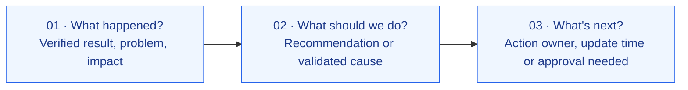
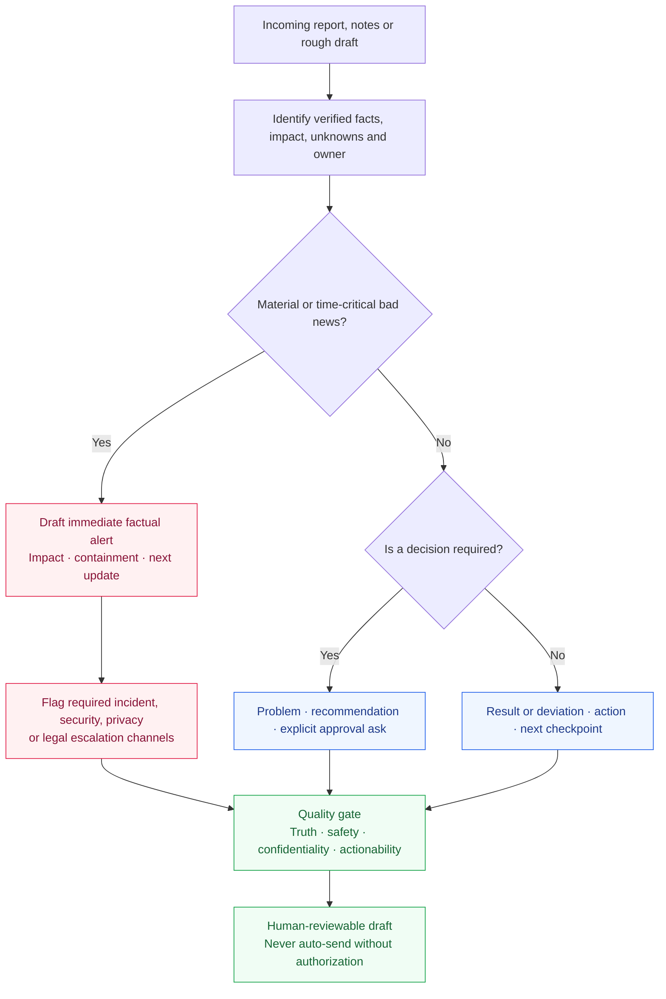
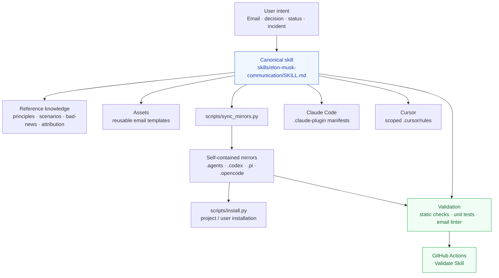

# Elon Musk Communication

**Decision-ready executive emails. Fast escalation of bad news. No invented facts.**

[](https://github.com/1998x-stack/Elon-Musk-Communication/actions/workflows/validate.yml)
[](LICENSE)

**English** · [简体中文](README.zh.md) · [Get started](#quick-start) · [Communication workflow](#decision-workflow) · [Architecture](#agent-skill-architecture) · [Examples](EXAMPLES.md) · [Attribution](skills/elon-musk-communication/references/evidence-and-attribution.md)

> **Make the next decision obvious.** Communicate what happened, what you recommend, and exactly what needs to happen next—while escalating material bad news immediately.

**Elon Musk Communication** is a portable, open-source [Agent Skill](skills/elon-musk-communication/SKILL.md) for drafting, rewriting, and reviewing concise executive updates. Inspired by *publicly reported* communication practices associated with Elon Musk and recollections of former Tesla executive Jon McNeill, it turns two memorable ideas into an explicit, verifiable workflow:

- **Three-Sentence Emails:** problem or result → recommendation or cause → next action or decision.
- **Bad News Travels Fast:** report verified adverse facts without waiting for a perfect explanation; state what is unknown, the containment underway, and the next checkpoint.

**Unofficial project.** This is not a Tesla, SpaceX, X, or Elon Musk publication or endorsement. The framework, prompt engineering, guardrails, and templates are maintained by this repository. [Read the evidence and attribution notes](skills/elon-musk-communication/references/evidence-and-attribution.md).

---

## Why this skill exists

Long emails are often poor decision interfaces. They bury the business impact, confuse hypotheses with facts, and ask readers to infer who must act. This skill optimizes for **accuracy first**, **timely escalation**, **decision clarity**, and **then brevity**.

| Failure mode | Behavioral rule | Expected output |
|:--|:--|:--|
| Status theater / long backstory | **Three-Sentence Emails** | A concise, decision-ready summary |
| Bad news delayed until root cause is known | **Bad News Travels Fast** | Early factual alert, containment and follow-up |
| Vague subject line or unclear request | **Make the ask executable** | Specific decision, owner, and deadline *when known* |
| Guesswork presented as certainty | **Facts before narratives** | Confirmed vs. suspected vs. unknown |
| Information trapped in a hierarchy | **Shortest responsible path** | Action owner involved without bypassing required processes |

### The three-sentence communication model



This is a **default format, not a hard word-count policy**. An executive incident alert may require additional sentences or a parallel incident log. Never sacrifice critical information or delay a safety, privacy, legal, or security notification to satisfy an email-length target.

## Decision workflow

The skill first classifies the request, then selects the right output. **Urgent bad news takes precedence over routine formatting.**



**Operational priority:** maintain accurate information and mandatory safety processes; alert promptly when there is a credible, actionable risk; make the requested action easy to understand; use brevity as a means, not an end. The agent writes or reviews a draft—it does **not** independently send or page.

## Quick start

### A. Claude Code plugin

In the Claude Code terminal, run:

```text
/plugin marketplace add 1998x-stack/Elon-Musk-Communication
/plugin install elon-musk-communication@elon-musk-communication
```

The repository includes a [marketplace manifest](.claude-plugin/marketplace.json) and [plugin metadata](.claude-plugin/plugin.json). Confirm the plugin has been installed and discovered in your Claude Code version.

### B. Install for Codex, Pi, OpenCode, Cursor, or Claude Code

```bash
git clone https://github.com/1998x-stack/Elon-Musk-Communication.git
cd Elon-Musk-Communication

# Preview the destination without writing files:
python3 scripts/install.py --agent codex --scope project --project /path/to/project --dry-run

# Install the complete skill and its reference files:
python3 scripts/install.py --agent codex --scope project --project /path/to/project
```

Replace `codex` with `claude`, `pi`, `opencode`, or `cursor`. Use `--scope user` for a personal installation. The installer **refuses to overwrite** an existing skill unless you explicitly pass `--force`.

| Agent | Project-level destination | Integration |
|:--|:--|:--|
| **Claude Code** | `.claude/skills/elon-musk-communication/` | Plugin or standalone skill |
| **Codex** | `.agents/skills/elon-musk-communication/` | Agent Skill; `.codex/skills/` also mirrored for custom workflows |
| **Pi** | `.pi/skills/elon-musk-communication/` | Portable Skill directory |
| **OpenCode** | `.opencode/skills/elon-musk-communication/` | Portable Skill directory |
| **Cursor** | `.cursor/skills/elon-musk-communication/` | Skill + [scoped project rule](.cursor/rules/elon-musk-communication.mdc) |

Paths and discovery behavior vary by agent version. Refer to [INSTALL.md](INSTALL.md) for user-level paths and verify that your agent actually discovers the installed skill. All installation methods retain the complete `references/` and `assets/` directories.

### C. Copy one prompt into your agent

```text
Install the executive communication Agent Skill from:
https://github.com/1998x-stack/Elon-Musk-Communication

Read skills/elon-musk-communication/SKILL.md, its referenced documents,
and the repo's installation guidance. Install the complete Skill in the
current agent's supported skills directory. Do not overwrite existing
files without permission. For my executive emails, distinguish verified
facts from hypotheses, structure routine updates around a clear decision,
and flag urgent bad news immediately rather than waiting to perfect
a three-sentence draft. Do not invent metrics, causes, or approvals.
```

## See the difference

**Before**

> We've had a busy week coordinating with several teams. There are some unexpected challenges around the release, and we're working hard to get everything back on track.

**After — decision request** *(all figures and circumstances are fictional examples)*

```text
Subject: [Decision by 16:00] Release delayed by 2 days

The release is two days behind schedule because two payment tests are blocked.
I recommend delaying launch until Thursday and assigning one engineer to the integration today.
Please approve the revised launch date by 16:00 so we can notify customers.
```

**After — material bad news** *(also fictional)*

```text
Subject: [Urgent] Customer export link exposed — access disabled

We confirmed one export link was reachable beyond its intended group
between 08:20 and 08:42 UTC; the affected data is still being assessed.
Access has been disabled, and Security and Privacy are coordinating
containment through the incident process.
The incident commander will provide a scope update at 09:15 UTC
and evaluate any required notifications.
```

The second example is **not** a substitute for the organization's incident response, paging, or legally required notification procedures. See [more fictional examples](EXAMPLES.md), [ready-to-fill templates](skills/elon-musk-communication/assets/templates/README.md), and the [bad-news playbook](skills/elon-musk-communication/references/bad-news-playbook.md).

## Agent Skill architecture

One **canonical** Skill defines behavior. Structured references, templates and automated checks support it. Mirrors make the **same complete directory** available to different agent ecosystems.



<details>
<summary><strong>Repository map</strong></summary>

```text
.
├── skills/elon-musk-communication/
│   ├── SKILL.md                      # Source of truth
│   ├── references/
│   │   ├── principles.md
│   │   ├── bad-news-playbook.md
│   │   ├── scenarios.md
│   │   └── evidence-and-attribution.md
│   └── assets/templates/README.md
├── .claude-plugin/                    # Claude marketplace + plugin
├── .cursor/rules/                    # Scoped communication rule
├── .agents/skills/                   # Codex conventional project path
├── .codex/skills/                    # Optional Codex-compatible mirror
├── .pi/skills/                       # Pi mirror
├── .opencode/skills/                 # OpenCode mirror
├── scripts/                          # Installer, mirror sync, validator, linter
├── tests/                            # Regression tests
├── .github/workflows/validate.yml   # Continuous validation
├── AGENTS.md / CLAUDE.md / CURSOR.md
├── INSTALL.md / EXAMPLES.md
└── README.md / README.zh.md
```

</details>

## Quality and safety guarantees

The agent should pass a **human-readable quality gate** before a draft is considered ready:

- **Accuracy:** verified facts remain intact; no invented amounts, dates, approvals, root causes, or completed actions.
- **Uncertainty:** suspected causes and unknown scope are labeled.
- **Actionability:** the recipient knows what decision is required, or who owns the next checkpoint.
- **Escalation:** material bad news is raised promptly through **required organizational channels**, without waiting for a polished email.
- **Confidentiality:** unnecessary personal data and restricted information are not added.
- **Authorization:** drafting is not sending; transmission requires explicit authorization.

The included linter checks **structure**, not truth or legal compliance. Human review and organizational incident policies remain necessary.

## Validation and contribution

The repository uses Python's standard library—**no runtime third-party Python dependencies**.

```bash
python3 scripts/sync_mirrors.py --check
python3 scripts/validate_skill.py
python3 -m unittest discover -s tests -v
python3 scripts/email_lint.py examples/sample-decision.txt
python3 scripts/email_lint.py --mode incident examples/sample-incident.txt
```

[GitHub Actions](.github/workflows/validate.yml) runs these checks on pushes and pull requests. To change behavior, edit the [canonical SKILL.md](skills/elon-musk-communication/SKILL.md), run `python3 scripts/sync_mirrors.py`, and rerun validation before submitting a PR. See [AGENTS.md](AGENTS.md) for contribution conventions.

## Sources, scope and license

The project draws inspiration from interviews with former Tesla executive Jon McNeill and reporting on Elon Musk's approach to communication. The **problem → root-cause analysis → proposal** and **problem → proposed solution → next action** variants are both treated as practical patterns, not as an inflexible, company-wide Musk rule. All diagrams, guardrails and scorecards here are repository-authored adaptations.

For links and important distinctions between reported accounts and project synthesis, read [Evidence & Attribution](skills/elon-musk-communication/references/evidence-and-attribution.md). This repository is **not affiliated with, sponsored by, or endorsed by Elon Musk or his companies**.

Licensed under [MIT](LICENSE).
