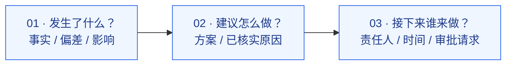
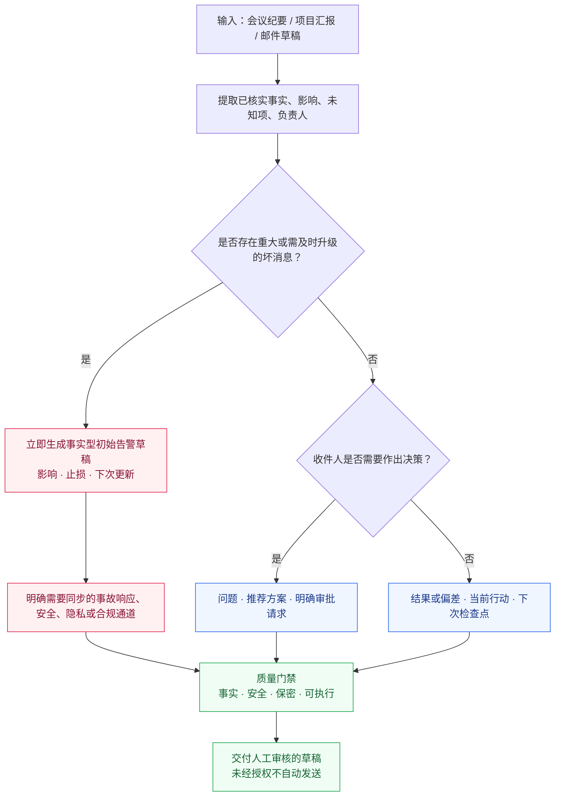
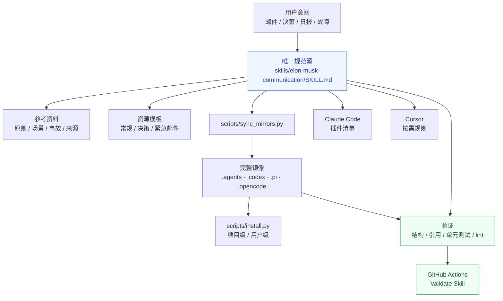

# Elon Musk Communication

**专业高管邮件沟通 Agent Skill｜三句话邮件 · 坏消息快速升级 · 以决策驱动沟通**

[](https://github.com/1998x-stack/Elon-Musk-Communication/actions/workflows/validate.yml)
[](LICENSE)

[English](README.md) · **简体中文** · [知乎深度文章](articles/zhihu/2026-11-12-three-sentence-emails-fast-bad-news.md) · [快速安装](#快速安装) · [沟通决策流程](#沟通决策流程) · [skill-架构](#skill-架构) · [案例库](EXAMPLES.md) · [证据来源](skills/elon-musk-communication/references/evidence-and-attribution.md)

> **一封好的汇报邮件，应该让收件人迅速理解事实、判断影响、执行下一步。** 简洁不是目的；及时、准确、可执行才是目的。

**Elon Musk Communication** 是一套可复用的开源 [Agent Skill](skills/elon-musk-communication/SKILL.md)，用于 CEO/高管邮件、项目汇报、决策审批、风险预警和紧急事件初始通报。它基于马斯克沟通方式的**公开报道与前特斯拉高管 Jon McNeill 的回忆**，将两个原则转化为可操作的工作流：

- **Three-Sentence Emails（三句话邮件）**：问题或成果 → 建议方案或已验证原因 → 明确行动或决策请求。
- **Bad News Travels Fast（坏消息立即上报）**：不等根因完全查清，先传递已确认事实、当前止损进度和下次更新时间。

**独立非官方项目。** 本项目不代表马斯克或 Tesla、SpaceX、X 的政策与认可。具体模板、安全边界、评分体系和 Agent 工作流由仓库维护者整理。详细区分见 [证据与来源](skills/elon-musk-communication/references/evidence-and-attribution.md)。

---

## 核心理念

| 常见沟通问题 | 对应原则 | 期望输出 |
|:--|:--|:--|
| 背景冗长、没有结论 | **三句话邮件** | 一屏内看清问题、方案和行动 |
| 坏消息拖到查清根因才报告 | **及时升级风险** | 事实、止损措施、下次更新时间 |
| 邮件无明确决策请求 | **行动与责任明确** | 具体请求、负责人及期限（如已知） |
| 猜测被写成确定事实 | **事实优先** | 明确区分已确认、怀疑、待查 |
| 信息反复转发、无人负责 | **最短的负责任路径** | 找到行动负责人，同时遵守必需的上报机制 |

### 三句话的逻辑



**注意：三句话是默认设计模式，不是僵硬的字数上限。** 涉及人身安全、隐私、安全事件、法律通知或重大生产事故时，优先确保及时上报与必要信息完整，不能为了压缩字数而延误处理。

## 沟通决策流程

Agent 首先识别沟通类型，然后选择结构。**重大坏消息高于普通邮件格式要求。**



本 Skill 的优先级是：**真实与安全 → 及时升级 → 可执行性 → 简洁表达**。Agent 负责生成、检查邮件内容；未经明确授权，不执行自动发送或事故系统操作。

## 快速安装

### 方法 A｜Claude Code 插件

在 Claude Code 中依次执行：

```text
/plugin marketplace add 1998x-stack/Elon-Musk-Communication
/plugin install elon-musk-communication@elon-musk-communication
```

仓库提供 [marketplace.json](.claude-plugin/marketplace.json) 与 [plugin.json](.claude-plugin/plugin.json)。请在 Claude Code 中确认插件实际被识别、已启用。

### 方法 B｜Codex、Pi、OpenCode、Cursor 和 Claude Code 通用安装

```bash
git clone https://github.com/1998x-stack/Elon-Musk-Communication.git
cd Elon-Musk-Communication

# 先查看目标路径，不写入文件
python3 scripts/install.py --agent codex --scope project --project /path/to/project --dry-run

# 安装完整 Skill（包含 references 和 templates）
python3 scripts/install.py --agent codex --scope project --project /path/to/project
```

将 `codex` 改为 `claude`、`pi`、`opencode` 或 `cursor`；通过 `--scope user` 安装到个人环境。默认**禁止覆盖已有文件**，只有明确使用 `--force` 才允许替换。

| Agent | 项目级安装位置 | 说明 |
|:--|:--|:--|
| **Claude Code** | `.claude/skills/elon-musk-communication/` | Skill 或插件 |
| **Codex** | `.agents/skills/elon-musk-communication/` | 标准发现路径；额外保留 `.codex/skills/` 镜像 |
| **Pi** | `.pi/skills/elon-musk-communication/` | 独立 Skill 目录 |
| **OpenCode** | `.opencode/skills/elon-musk-communication/` | 独立 Skill 目录 |
| **Cursor** | `.cursor/skills/elon-musk-communication/` | Skill + [限定范围的规则文件](.cursor/rules/elon-musk-communication.mdc) |

不同版本的 Agent 可能存在路径及发现行为差异；个人级安装路径见 [INSTALL.md](INSTALL.md)。安装完成后请在对应 Agent 中确认 Skill 可被发现。

### 方法 C｜只复制一个 Prompt

```text
从 https://github.com/1998x-stack/Elon-Musk-Communication
读取 skills/elon-musk-communication/SKILL.md 及其 references、assets，
根据当前 Agent 的支持方式安装完整 Skill，不要未经确认覆盖已有文件。

今后我要求写 CEO/高管邮件、项目状态更新、审批请求、风险升级时，
请区分已确认事实、推测和未知事项，用简洁的结构写出问题、建议和行动。
如属于重大坏消息，请优先提出及时升级的事实型告警，不要为了凑三句话
而隐瞒事实、假设根因或耽误必要的应急上报；未经授权不要发送邮件。
```

## 改写效果对比

**原文**

> 近期我们在跨团队协作过程中遇到一些预料之外的问题，但大家都在积极沟通、努力推进，后续将持续关注项目进展。

**改写后：决策请求（以下数值均为虚构示例）**

```text
Subject: [Decision by 16:00] Release delayed by 2 days

The release is two days behind schedule because two payment tests are blocked.
I recommend delaying launch until Thursday and assigning one engineer to the integration today.
Please approve the revised launch date by 16:00 so we can notify customers.
```

**改写后：重大坏消息（同为虚构示例）**

```text
Subject: [Urgent] Customer export link exposed — access disabled

We confirmed one export link was reachable beyond its intended group
between 08:20 and 08:42 UTC; the affected data is still being assessed.
Access has been disabled, and Security and Privacy are coordinating
containment through the incident process.
The incident commander will provide a scope update at 09:15 UTC
and evaluate any required notifications.
```

重大事件的邮件**不能取代**事故响应、值班通知、安全与法律合规流程。阅读 [更多示例](EXAMPLES.md)、[邮件模板](skills/elon-musk-communication/assets/templates/README.md) 和 [坏消息升级手册](skills/elon-musk-communication/references/bad-news-playbook.md)。

## Skill 架构

本项目采取 **单一规范源（Single Source of Truth）+ 按需读取的 References + 跨 Agent 自包含镜像 + 自动化质量验证** 的设计。



<details>
<summary><strong>展开仓库目录</strong></summary>

```text
.
├── skills/elon-musk-communication/
│   ├── SKILL.md                     # 唯一规范来源
│   ├── references/
│   │   ├── principles.md
│   │   ├── bad-news-playbook.md
│   │   ├── scenarios.md
│   │   └── evidence-and-attribution.md
│   └── assets/templates/README.md
├── .claude-plugin/                   # Claude 插件和 Marketplace
├── .cursor/rules/                   # Cursor 按需规则
├── .agents/skills/                  # Codex 项目级发现目录
├── .codex/skills/                   # Codex 可选镜像
├── .pi/skills/                      # Pi 镜像
├── .opencode/skills/                # OpenCode 镜像
├── scripts/                         # 安装、同步、验证、邮件检查
├── tests/                           # 回归测试
├── .github/workflows/validate.yml  # GitHub CI
├── AGENTS.md / CLAUDE.md / CURSOR.md
├── INSTALL.md / EXAMPLES.md
└── README.md / README.zh.md
```

</details>

## 输出质量门禁

一封达到交付标准的邮件至少应满足：

- **事实可核实：** 不虚构数据、预算、授权、根因或已完成行动。
- **不确定性明确：** 将确认事实、待验证假设、未知影响严格区分。
- **行动清楚：** 收件人知道应该批准什么，或由谁在何时推进下一步。
- **坏消息不拖延：** 第一时间提示真实风险及应使用的正式升级渠道。
- **保密合规：** 不增加无必要的客户隐私、敏感信息。
- **发送可控：** 草稿不等于已发送，必须获得明确授权。

仓库内置的邮件检查脚本主要检查**格式结构**，并不能自动证明内容真实性或法律合规。涉及真实风险时，仍应经过人工复核并遵循组织制度。

## 本地验证与贡献

仅使用 Python 标准库，**不需要第三方 Python 运行依赖**。

```bash
python3 scripts/sync_mirrors.py --check
python3 scripts/validate_skill.py
python3 -m unittest discover -s tests -v
python3 scripts/email_lint.py examples/sample-decision.txt
python3 scripts/email_lint.py --mode incident examples/sample-incident.txt
```

[GitHub Actions](.github/workflows/validate.yml) 会在 Push 和 Pull Request 时自动校验。开发时请先修改 [canonical SKILL.md](skills/elon-musk-communication/SKILL.md)，执行 `python3 scripts/sync_mirrors.py` 同步镜像，再运行测试。具体维护规范参见 [AGENTS.md](AGENTS.md)。

## 来源、限制与许可证

本 Skill 基于 Jon McNeill 的公开访谈及马斯克沟通方式相关报道构建。**「问题 → 根因分析 → 方案」** 和 **「问题 → 方案 → 下一步」** 是两个可适配的实用表达模型，不能被描述为适用于所有场合的马斯克官方强制制度。README 中的 Mermaid 图、执行规则、质量门禁和示例均为仓库维护者设计。

详细见 [来源与证据说明](skills/elon-musk-communication/references/evidence-and-attribution.md)。本项目与马斯克本人及其公司**不存在隶属、赞助或官方认可关系**。

开源许可证：[MIT](LICENSE)。
